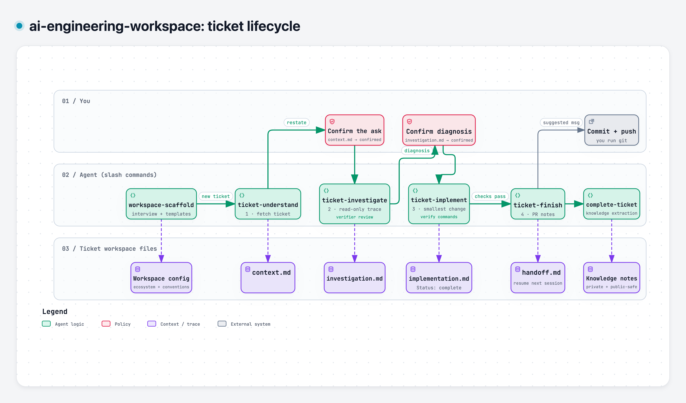

# ai-engineering-workspace

A ticket suite for AI-assisted engineering: workspace scaffolding, a
phase-gated ticket workflow, structured bug fixing, cross-session handoff, and
ticket completion knowledge extraction.

[中文版](README.zh-CN.md)

## Why

AI coding sessions are short-lived and start with no memory; engineering
tickets are long-lived and span many sessions. This suite externalizes session
memory into files, so each ticket becomes a self-contained context package:

```text
Problem context + code ownership + investigation evidence + next safe action
```

Any new session (Claude Code, Cursor, Codex, …) can pick up a ticket cold —
without repeating investigations, editing the wrong repo, mixing facts with
guesses, or losing test and acceptance status.

## Workflow



Interactive version: [docs/ticket-lifecycle.html](docs/ticket-lifecycle.html) (download and open locally).

## What's inside

| Skill | Use when | Without a workspace |
| --- | --- | --- |
| `ai-engineering-workspace` | Scaffolding a workspace, or choosing between the skills below | — |
| `ticket-workflow` | Working a ticket end to end through four gated phases | Same phases, gated by confirmations in the conversation |
| `structured-bug-fix` | Diagnosing a bug, especially when the symptom and root cause live in different repos or layers | Works in any repo |
| `handoff` | Saving state before a session ends, or resuming one | Uses `.handoff/HANDOFF.md` at repo root |
| `complete-ticket` | Turning a finished ticket into durable private and public-safe knowledge | Draft mode only |

Commands (user-invoked only — the model cannot call them on its own):

| Command | Purpose |
| --- | --- |
| `/ai-engineering-workspace:workspace-scaffold [path]` | Create or upgrade a ticket workspace |
| `/ai-engineering-workspace:ask [ID]` | Read-only router: read the ticket's `Status:` fields and recommend the next command |
| `/ai-engineering-workspace:ticket-understand <ID>` | Phase 1 — fetch the ticket and comments, confirm the ask before touching code |
| `/ai-engineering-workspace:ticket-investigate <ID>` | Phase 2 — read-only: trace the flow, confirm root cause and owner |
| `/ai-engineering-workspace:ticket-implement <ID>` | Phase 3 — smallest safe change, then run the verification commands |
| `/ai-engineering-workspace:ticket-finish <ID>` | Phase 4 — PR notes, a commit report for the implementation repo, handoff |

Hook: on `SessionStart` (startup, resume, clear, compact),
`scripts/handoff-check.sh` looks for `tickets/*/handoff.md` and
`.handoff/*.md` in the current directory and, if any exist, reminds the agent
to resume from them. It prints nothing otherwise.

## Phase gates

Each phase is a separate command, so the agent cannot see a later phase's
instructions until you run it. Every gate is backed by a literal `Status:`
line in a ticket file:

| File | Status | Who flips it |
| --- | --- | --- |
| `context.md` | `draft` → `confirmed` | You, after confirming the agent's restatement of the ask |
| `investigation.md` | `draft` → `confirmed` | You, after confirming the diagnosis |
| `implementation.md` | `draft` → `complete` | The agent, once every configured verification command passed or is `N/A` |

During investigation, a fresh adversarial verifier reviews the diagnosis. It
only returns a verdict — it never writes files or changes `Status:` — and a
PASS is necessary but never sufficient: the human still confirms.

## Quick start

Install from this marketplace:

```text
/plugin marketplace add weiwei-tsao/my-skills-marketplace
/plugin install ai-engineering-workspace@my-skills
```

Set up a workspace (the command interviews you about repos, data flow, ticket
IDs, stages, conventions, and location):

```text
/ai-engineering-workspace:workspace-scaffold
```

Start a ticket:

```bash
$WORKSPACE_ROOT/scripts/new-ticket.sh ABC-123 "short title"
```

```text
/ai-engineering-workspace:ticket-understand ABC-123
```

Then follow `/ai-engineering-workspace:ask ABC-123` for the next step.

## Workspace layout

A directory containing `ecosystem.md` and `tickets/` is a workspace. It is
often a separate notes repo rather than the implementation repo, so every
skill addresses it through an explicit `$WORKSPACE_ROOT` path.

```text
<workspace>/
  ecosystem.md            repos, ownership, how a request travels through them
  conventions.md          ticket IDs and source, verification commands,
                          branch/commit/PR format, where design questions go
  tickets/_template/      context, investigation, implementation, test,
                          pr, timeline, handoff
  tickets/<ID>/           one folder per ticket; files appear as phases need them
  scripts/new-ticket.sh   creates tickets/<ID>/context.md
```

## Ground rules

All skills in the suite follow these:

- No code edits before root cause and owner are reasonably confirmed.
- Check repo, branch, `git status`, and diff before editing.
- Smallest safe change — no unrelated formatting or refactors.
- Keep facts (with evidence), hypotheses, and decisions apart.
- Follow the evidence, not the user's expected answer; say so when they
  conflict.
- Never end a session without a useful handoff.
- **Implementation repo:** the agent never runs `git commit` or `git push`. It
  reports the changed files and a suggested commit message; you commit.
- **Notes repo:** the agent may commit tracking files only when
  `conventions.md`'s "Notes repo automation" field allows it.

## Handoff

A handoff file replaces the old session's history, so it stays small
(about 1,500–2,500 tokens). Sections are treated by how fast they go stale:

| Section | On resume |
| --- | --- |
| Code facts | Verify first — each carries a `path :: symbol` anchor |
| Decisions | Trust unless the requirement changed |
| Progress | The cursor; updated every save |
| Dead ends | Append-only "don't retry" list |

## Ticket completion

`complete-ticket` produces four artifacts: a private closure record, private
repo relationship notes, public-safe technical notes, and public-safe system
design lessons. Strict mode (the default) stops with a missing-evidence
checklist if root cause, owner, implementation, tests, PR, or
acceptance/deploy status are not recorded. Draft mode runs only when you ask
for it and labels every gap.

Optional companions, loaded by name when installed: `weiwei-notes` (public-safe
redaction and writing rules) and `system-design-coach` (design review rubric).
