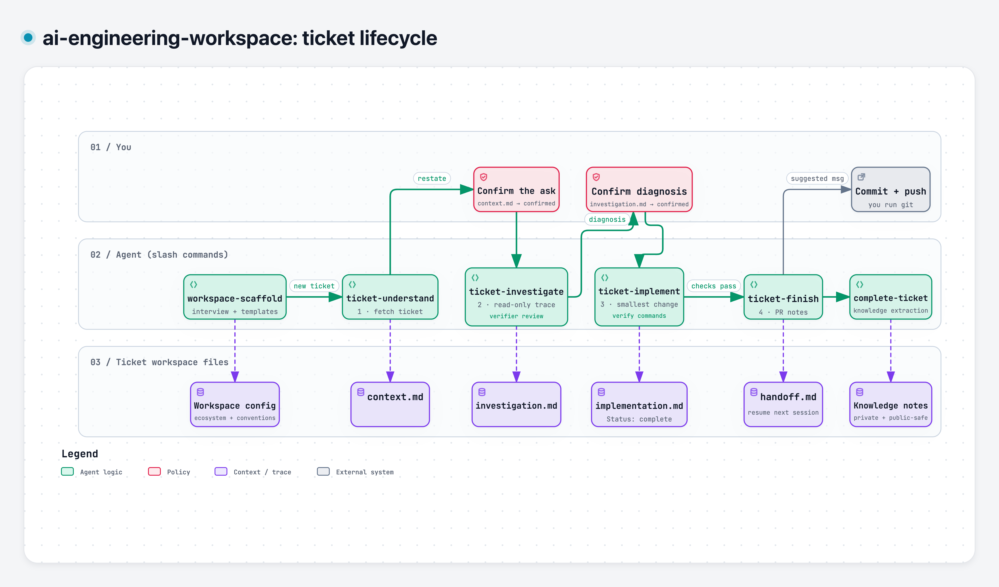

# ai-engineering-workspace

一套给 AI 辅助开发用的 ticket 工具：搭建工作区、分阶段推进 ticket、结构化修 bug、跨会话交接，以及结案时把 ticket 沉淀成知识。

[English](README.md)

## 为什么需要它

AI 编程会话很短，每次都从零开始；而一个工程 ticket 往往要跨好几个会话才能做完。这套工具把会话里的记忆写进文件，让每个 ticket 都成为一个自包含的上下文包：

```text
问题背景 + 代码归属 + 调查证据 + 下一步安全动作
```

新开任何一个会话（Claude Code、Cursor、Codex……）都能直接接手：不会重复调查，不会改错 repo，猜测不会混进事实，测试和验收进度也不会丢。

## 流程



可交互版本：[docs/ticket-lifecycle.html](docs/ticket-lifecycle.html)（下载后在本地打开）。

## 包含什么

| Skill | 什么时候用 | 没有 workspace 时 |
| --- | --- | --- |
| `ai-engineering-workspace` | 搭建工作区，或在下面几个 skill 之间选一个 | — |
| `ticket-workflow` | 按四个带门槛的阶段把一个 ticket 从头做到尾 | 阶段相同，靠对话里的确认放行 |
| `structured-bug-fix` | 诊断 bug，尤其是现象和根因不在同一个 repo 或同一层的时候 | 任何 repo 都能用 |
| `handoff` | 会话结束前存档，或恢复上一个会话 | 存到 repo 根目录的 `.handoff/HANDOFF.md` |
| `complete-ticket` | 把做完的 ticket 沉淀成私有记录和可公开的知识 | 只能出草稿 |

命令（只能由用户调用，模型不能自己触发）：

| 命令 | 作用 |
| --- | --- |
| `/ai-engineering-workspace:workspace-scaffold [path]` | 创建或升级 ticket 工作区 |
| `/ai-engineering-workspace:ask [ID]` | 只读路由：读 ticket 的 `Status:` 字段，告诉你下一步运行哪个命令 |
| `/ai-engineering-workspace:ticket-understand <ID>` | 阶段 1：拉取 ticket 和评论，在碰代码之前确认需求 |
| `/ai-engineering-workspace:ticket-investigate <ID>` | 阶段 2：先查已有知识，再只读调查，追数据流，确认根因和归属 |
| `/ai-engineering-workspace:ticket-implement <ID>` | 阶段 3：做最小的安全改动，然后跑验证命令 |
| `/ai-engineering-workspace:ticket-finish <ID>` | 阶段 4：PR 说明、给实现 repo 的 commit 报告、handoff |

Hook：在 `SessionStart`（启动、resume、clear、compact）时，`scripts/handoff-check.sh` 会在当前目录下找 `tickets/*/handoff.md` 和 `.handoff/*.md`。找到了就提醒 agent 先从这些文件恢复上下文，找不到就什么都不输出。

## 阶段门槛

每个阶段都是一个独立命令，所以在你运行下一个命令之前，agent 看不到后面阶段的指令。每道门槛都对应 ticket 文件里一行写死的 `Status:`：

| 文件 | Status | 由谁改 |
| --- | --- | --- |
| `context.md` | `draft` → `confirmed` | 你，确认 agent 对需求的复述之后 |
| `investigation.md` | `draft` → `confirmed` | 你，确认诊断结论之后 |
| `implementation.md` | `draft` → `complete` | agent，所有配置的验证命令都通过（或标为 `N/A`）之后 |

调查阶段会另开一个对抗式 verifier 来审诊断。它只给判定，从不写文件、也不改 `Status:`。它给 PASS 是必要条件，但不够：最后仍然要人来确认。

## 快速开始

从本 marketplace 安装：

```text
/plugin marketplace add weiwei-tsao/my-skills-marketplace
/plugin install ai-engineering-workspace@my-skills
```

搭建工作区（命令会问你有哪些 repo、数据怎么流转、ticket ID 格式、上线前有哪些环境、团队规范，以及工作区放在哪）：

```text
/ai-engineering-workspace:workspace-scaffold
```

开一个 ticket：

```bash
$WORKSPACE_ROOT/scripts/new-ticket.sh ABC-123 "short title"
```

```text
/ai-engineering-workspace:ticket-understand ABC-123
```

之后按 `/ai-engineering-workspace:ask ABC-123` 的建议往下走。

## 工作区结构

一个同时包含 `ecosystem.md` 和 `tickets/` 的目录就是工作区。它常常是一个单独的笔记 repo，而不是代码所在的 repo，所以所有 skill 都通过明确的 `$WORKSPACE_ROOT` 路径访问它。

```text
<workspace>/
  ecosystem.md            有哪些 repo、各自负责什么、请求怎么在它们之间流转
  conventions.md          ticket ID 和来源、知识来源、验证命令、
                          分支/commit/PR 格式、设计问题在哪里讨论
  tickets/_template/      context、investigation、implementation、test、
                          pr、timeline、handoff
  tickets/<ID>/           每个 ticket 一个目录；文件到对应阶段才创建
  scripts/new-ticket.sh   创建 tickets/<ID>/context.md
```

## 基本规则

套件里所有 skill 都遵守：

- 根因和归属没有基本确认之前，不改代码。
- 改之前先看 repo、分支、`git status` 和 diff。
- 改动尽量小，不顺手格式化或重构无关代码。
- 事实（有证据）、假设、决策分开写。
- 跟着证据走，不迎合用户预期的答案；两者冲突时直接说出来。
- 结束会话前一定留下可用的 handoff。
- **实现 repo**：agent 从不运行 `git commit` 或 `git push`，只报告改了哪些文件并给一条建议的 commit message，由你来提交。
- **笔记 repo**：只有 `conventions.md` 的 "Notes repo automation" 字段允许时，agent 才能提交跟踪文件。

## Handoff

handoff 文件用来代替旧会话的历史，所以要保持精简（大约 1,500–2,500 tokens）。各部分按"过期速度"区别对待：

| 部分 | 恢复时怎么处理 |
| --- | --- |
| 代码事实 | 先核实，每条都带 `path :: symbol` 锚点 |
| 决策 | 需求没变就可以信 |
| 进度 | 游标，每次存档都更新 |
| 死胡同 | 只追加，作为"别再试"清单 |

## 已有知识

Investigate 开始时，会先读 `conventions.md` 的 "Knowledge sources" 里列出的跨 ticket 知识索引（默认是 `complete-ticket` 的 `knowledge/private/repo-relationships-index.md`，也可以加上你自己的，比如按领域整理的 findings 文件）。只打开和本 ticket 匹配的条目所指的文档，并且只当作线索、不当作证据：每条在支撑任何结论之前，都要对照当前代码重新核实，然后记在 `investigation.md` 的 `## Prior knowledge` 里，标为 ✅ 已确认、⚠️ 已变化、❌ 已不存在或被推翻，或"未使用"。没有匹配的条目时，用一行说明，然后照常调查。

## 结案

`complete-ticket` 产出四份内容：私有的结案记录、私有的 repo 关系笔记、可公开的技术笔记、可公开的系统设计心得。默认是严格模式：根因、归属、实现、测试、PR、验收或部署状态，任何一项没有记录，就停下来列出缺失清单。草稿模式只在你明确要求时才运行，并会标出每一处缺口。

可选搭配（装了就按名字加载）：`weiwei-notes`（脱敏和写作规则）和 `system-design-coach`（设计评审标准）。
